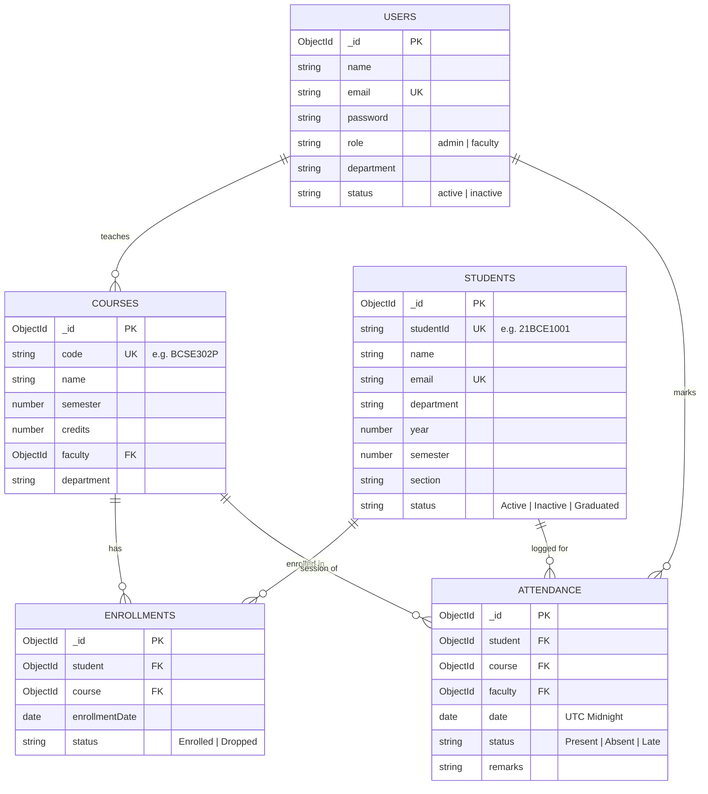

# Database Design Document: Student Attendance Management System
**Course:** BCSE302P – Database Systems Lab  
**Evaluation:** Review 3  
**Database:** MongoDB 9.0 (Document-Oriented NoSQL)  

---

## 1. Problem Statement & Scope

Traditional attendance tracking in higher education institutions relies heavily on paper registers or monolithic relational databases with rigid schemas. These manual or legacy systems suffer from:
- Slow query performance when aggregating attendance percentages across thousands of sessions.
- Difficulty managing variable elective courses and flexible enrollment structures.
- Risk of duplicate attendance logs due to poor constraint enforcement.
- Cumbersome generation of analytical reports (e.g., detecting students falling below the mandatory 75% threshold).

### System Scope
The **Student Attendance Management System** provides an automated, full-stack solution allowing administrators and faculty members to register students, define academic courses, enroll student cohorts, record session-level attendance with real-time status toggles, and execute server-side MongoDB aggregation pipelines for instant analytical insights.

---

## 2. Why MongoDB? (NoSQL vs. Relational DBMS)

For this attendance tracking platform, MongoDB was selected over traditional relational systems (such as MySQL or PostgreSQL) for specific technical reasons:

1. **Document Model Natural Mapping**:
   Attendance sheets, daily rosters, and complex aggregation results map directly to JSON/BSON documents used by modern React and Node.js applications without an impedance mismatch.
2. **High Write Throughput for Concurrent Attendance Logging**:
   During peak class hours, hundreds of faculty members submit attendance sessions concurrently. MongoDB provides fast, low-latency document-level locking (`WiredTiger` storage engine) and efficient bulk upsert capabilities (`bulkWrite`).
3. **Powerful Native Aggregation Pipeline Framework**:
   MongoDB's multi-stage aggregation pipeline (`$group`, `$project`, `$lookup`, `$match`, `$unwind`) allows heavy analytics—such as computing percentages, historical trends, and dynamic defaulter lists—to run natively inside the database engine without sending raw session records over the network.
4. **Flexible Schema with Validation Rules**:
   Academic structures frequently change (e.g., adding remarks, new elective categories, or lab session metadata). Mongoose allows strict schema enforcement while retaining the flexibility of document storage.

---

## 3. Entity-Relationship (ER) Diagram



---

## 4. Collection Schemas & Data Dictionary

### Collection 1: `users`
Stores system accounts for administrators and teaching faculty.

| Field | Type | Validation / Constraints | Description |
| :--- | :--- | :--- | :--- |
| `_id` | ObjectId | Primary Key (auto-generated) | Unique document ID |
| `name` | String | Required, Trim, Max: 100 | Full name of the faculty/admin |
| `email` | String | Required, Unique, Lowercase, Regex | Login email address |
| `password` | String | Required, Min: 6, Hashed (bcrypt) | Salted password hash |
| `role` | String | Enum: `['admin', 'faculty']` | Access privilege role |
| `department`| String | Default: `'CSE'` | Associated academic department |
| `status` | String | Enum: `['active', 'inactive']` | Account activation state |
| `timestamps`| Date | Auto: `createdAt`, `updatedAt` | Audit timestamps |

### Collection 2: `students`
Stores undergraduate student demographic and cohort information.

| Field | Type | Validation / Constraints | Description |
| :--- | :--- | :--- | :--- |
| `_id` | ObjectId | Primary Key (auto-generated) | Unique document ID |
| `studentId`| String | Required, Unique, Uppercase, Trim | Registration number (e.g. `21BCE1001`) |
| `name` | String | Required, Trim, Max: 100 | Student legal name |
| `email` | String | Required, Unique, Lowercase, Regex | Student university email |
| `department`| String | Required, Default: `'CSE'` | Academic branch |
| `year` | Number | Min: 1, Max: 4, Default: 3 | Current study year |
| `semester` | Number | Min: 1, Max: 8, Default: 5 | Current active semester |
| `section` | String | Default: `'A'`, Uppercase | Class section |
| `status` | String | Enum: `['Active', 'Inactive', 'Graduated']` | Student status |

### Collection 3: `courses`
Stores academic courses and assigned instructors.

| Field | Type | Validation / Constraints | Description |
| :--- | :--- | :--- | :--- |
| `_id` | ObjectId | Primary Key (auto-generated) | Unique document ID |
| `code` | String | Required, Unique, Uppercase | Course code (e.g. `BCSE302P`) |
| `name` | String | Required, Trim | Descriptive course title |
| `semester` | Number | Min: 1, Max: 8, Default: 5 | Target semester |
| `credits` | Number | Min: 1, Max: 6, Default: 3 | Academic credits |
| `faculty` | ObjectId | Required, Ref: `'User'` | Foreign Key referencing instructor |
| `status` | String | Enum: `['Active', 'Archived']` | Course availability |

### Collection 4: `enrollments`
Represents the many-to-many relationship linking students to registered courses.

| Field | Type | Validation / Constraints | Description |
| :--- | :--- | :--- | :--- |
| `_id` | ObjectId | Primary Key (auto-generated) | Unique document ID |
| `student` | ObjectId | Required, Ref: `'Student'` | Enrolled student reference |
| `course` | ObjectId | Required, Ref: `'Course'` | Course offering reference |
| `enrollmentDate`| Date | Default: `Date.now` | Registration date |
| `status` | String | Enum: `['Enrolled', 'Dropped', 'Completed']` | Enrollment state |

### Collection 5: `attendance`
Stores atomic attendance records for individual student-course lecture sessions.

| Field | Type | Validation / Constraints | Description |
| :--- | :--- | :--- | :--- |
| `_id` | ObjectId | Primary Key (auto-generated) | Unique document ID |
| `student` | ObjectId | Required, Ref: `'Student'` | Student reference |
| `course` | ObjectId | Required, Ref: `'Course'` | Course reference |
| `faculty` | ObjectId | Required, Ref: `'User'` | Faculty who logged session |
| `date` | Date | Required, Normalized to UTC Midnight | Date of lecture session |
| `status` | String | Enum: `['Present', 'Absent', 'Late']` | Session status |
| `remarks` | String | Max: 200, Trim, Optional | OD justification or notes |

---

## 5. Indexing Strategy & Integrity Enforcement

Indexes in MongoDB are critical for both query acceleration and database integrity:

### 1. Unique Compound Indexes (Constraint Enforcement)
- **Duplicate Enrollment Prevention**:
  ```javascript
  enrollmentSchema.index({ student: 1, course: 1 }, { unique: true });
  ```
  *Purpose:* Guarantees that a student cannot be enrolled in the same course more than once. Any duplicate attempt throws code `11000`.

- **Duplicate Attendance Entry Prevention**:
  ```javascript
  attendanceSchema.index({ student: 1, course: 1, date: 1 }, { unique: true });
  ```
  *Purpose:* Enforces the strict rule that for a given student in a given course, only one attendance record may exist per calendar day. In combination with the pre-save hook that strips time to UTC midnight, duplicate marks are mathematically prevented.

### 2. Performance Query Indexes
- **Student ID Lookup**:
  ```javascript
  studentSchema.index({ studentId: 1 }, { unique: true });
  ```
- **Department & Semester Compound Search**:
  ```javascript
  studentSchema.index({ department: 1, semester: 1 });
  ```
- **Course-Date Roster Retrieval**:
  ```javascript
  attendanceSchema.index({ course: 1, date: 1 });
  ```
  *Purpose:* Enables $O(1)$ indexed retrieval of all student records when a faculty member opens the attendance sheet for a specific lecture date.

- **Student Attendance History Retrieval**:
  ```javascript
  attendanceSchema.index({ student: 1, date: -1 });
  ```

---

## 6. Sample Data Generation Summary

The automated database seeder (`backend/seed/seedData.js`) establishes:
- **4 User accounts** (1 Admin, 3 Faculty members)
- **5 Courses** (`BCSE302P`, `BCSE301L`, `BCSE303P`, `BCSE308L`, `BCSE309P`)
- **30 Students** (`21BCE1001` through `21BCE1030`)
- **98 Enrollments**
- **360 Attendance documents** logged across 10 session dates
- **Total: 497 documents**, creating a realistic dataset with naturally occurring defaulters for live demonstration.
